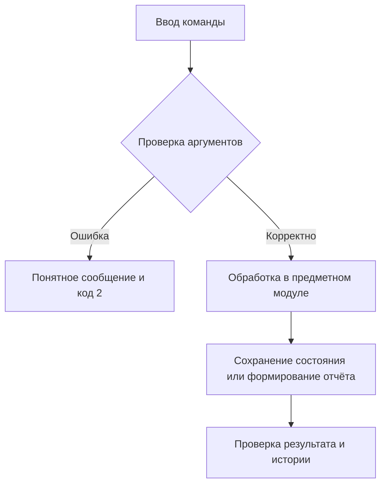

# Отчёт. Практическая работа №19–20

## Задание 3. Контроль конфигурации файлов

Дата: 5 ноября 2026 года.

## Цель

Разработать работающее приложение по заданию 3, проверить корректность,
организовать версионность и документировать применённые практики управления конфигурацией.

## Архитектура

Модуль core: scan, create_baseline, compare; JSON baseline и дописываемый JSONL-журнал проверок.

Стек: Python 3.11/3.12, стандартная библиотека, pytest 8.3.5, ruff 0.11.13;
сборщик hatchling 1.27.0. Зависимости фиксируются в pyproject.toml и uv.lock.
Консольный интерфейс — src/configuration_control/cli.py, логика — src/configuration_control/core.py,
тесты — tests/.

## Схема алгоритма

Каталог → исключения → относительные пути + SHA-256 → утверждённая baseline → повторный снимок → added/removed/changed.



## Основной фрагмент реализации

Код из src/configuration_control/core.py, функция compare:

```python
def compare(directory, snapshot, history=None, report=None):
    baseline = read_baseline(snapshot)
    ignore = list(baseline["excludes"])
    root = Path(directory).resolve()
    for output in (history, report):
        if output and Path(output).resolve().is_relative_to(root):
            ignore.append(Path(output).resolve().relative_to(root).as_posix())
    current, old = scan(root, ignore), baseline["items"]
    result = {
        "baseline": baseline["id"],
        "date": datetime.now(timezone.utc).isoformat(),
        "added": sorted(current.keys() - old.keys()),
        "removed": sorted(old.keys() - current.keys()),
        "changed": sorted(
            k for k in current.keys() & old.keys() if current[k]["sha256"] != old[k]["sha256"]
        ),
    }
    if report:
        Path(report).write_text(json.dumps(result, ensure_ascii=False, indent=2), encoding="utf-8")
    if history:
        with Path(history).open("a", encoding="utf-8") as stream:
            stream.write(json.dumps(result, ensure_ascii=False) + "\n")
    return result
```

Полный исходный код находится рядом с отчётом. Для защиты работы следует разобрать
его самостоятельно; происхождение реализации не представляется как подтверждение
самостоятельного написания студентом.

## Запуск и полученные результаты

Команда демонстрации: `uv run python examples/demo.py` в отдельно клонированном проекте;
в общем workspace: `uv run --all-packages python configuration-control/examples/demo.py` из корня.

```text
{'baseline': 'BL-001', 'date': '2026-11-05T11:37:12.480255+00:00', 'added': ['README.md'], 'removed': ['old.txt'], 'changed': ['app.py']}
```

Основное свидетельство: [examples/differences.json](examples/differences.json).
Локальные тесты: **12 passed in 0.02s**. Ruff и справка CLI: успешно.
Полный протокол: [examples/verification.txt](examples/verification.txt).
Общий набор: **94 теста пройдены на Python 3.12.14 и Python 3.11.16**.
Эти протоколы получены локально и не выдаются за GitHub Actions.

## Git и прослеживаемость

Каждый каталог — отдельный настоящий Git-репозиторий. История создавалась по этапам:
настройка пакета → функции → CLI → тесты → документация → демонстрации и проверка.
Функциональные ветки сохраняются после локального слияния; дата коммитов не подменялась.
Тег v1.0.0 фиксирует завершённое локальное состояние.

```text
feature-diff
feature-scan
main
```

Проверка: `git log --graph --oneline --all`, `git branch`, `git tag`, `git show v1.0.0`.
Подробные снимки всех репозиториев собраны в ../git-evidence.json.

Два снимка: examples/BL-001.json и BL-002.json; цепочка previous сохранена.
Проверяемая история файлов: examples/demo-history.bundle.

## Ограничения и вывод

Неизменяемость обеспечивается приложением (создание файла в режиме x), а не правами ОС. ID уникальны внутри каталога baseline. Во время сканирования файлы не блокируются; символьные ссылки исключены.

Приложение выполняет локальные функциональные требования и имеет автоматизированные
проверки. Реализованные практики SCM и организационные правила описаны в SCMP.md.
Использование отдельных принципов ISO/IEC/IEEE 828:2012 не доказывает полного
соответствия стандарту. GitHub-подтверждения, где они требуются, собраны в CI_EVIDENCE.md.

Репозиторий: [darklezzzz/configuration-control](https://github.com/darklezzzz/configuration-control).
